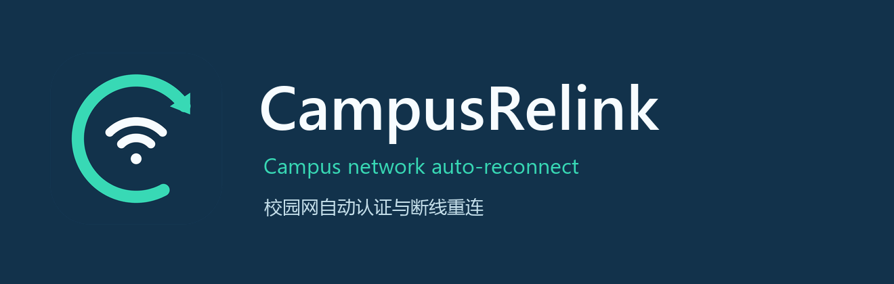
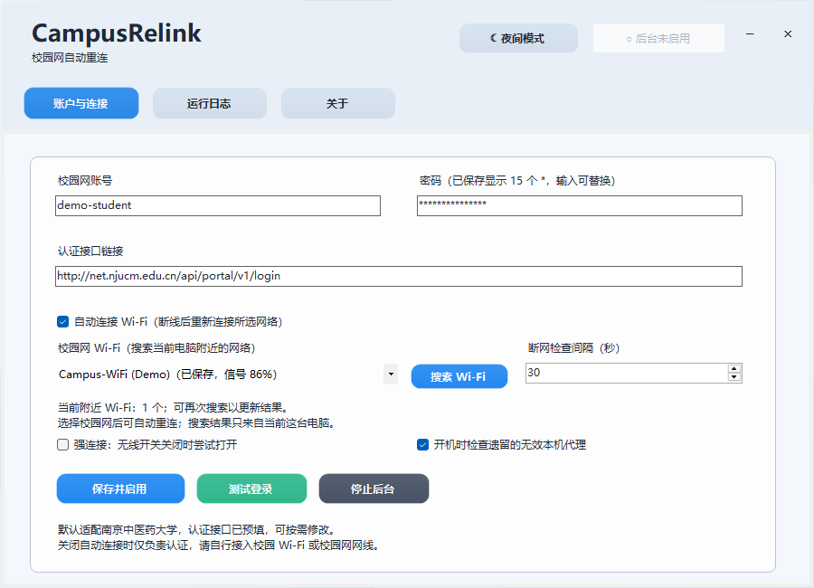
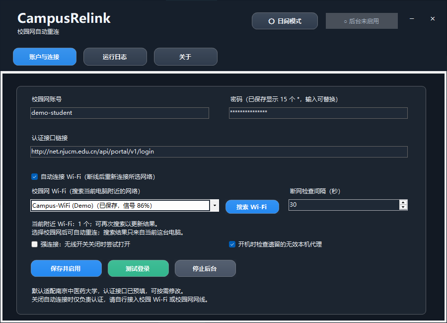

<p align="center">
  
</p>

<h1 align="center">CampusRelink</h1>

<p align="center">自动认证，断线重连，安静驻留托盘。<br>适用于 Windows 的校园网连接工具。</p>

<p align="center">
  
  
  
  <a href="LICENSE"></a>
</p>

<p align="center">
  简体中文 · <a href="README.en.md">English</a>
</p>

<p align="center">
  <a href="#quick-start">下载与使用</a> ·
  <a href="#preview">界面预览</a> ·
  <a href="#compatibility">适配与隐私</a> ·
  <a href="#faq">常见问题</a> ·
  <a href="#development">参与开发</a> ·
  <a href="https://github.com/fcwll666/CampusRelink/releases">Releases</a> ·
  <a href="https://github.com/fcwll666/CampusRelink/issues">反馈问题</a>
</p>

CampusRelink 使用一组账号与密码，在离线时完成校园网认证，并在连接中断后尝试恢复。它可以驻留托盘，按需自动连接已保存的 Wi-Fi，也可以只在当前有线或无线网络上认证。

**当前默认适配南京中医药大学。** 登录 URL 可编辑，内置协议仍只有一种 Srun 风格预设；更换地址不代表适配其他学校或所有 Srun 部署。详见 [连接与认证配置](docs/PORTAL-CONFIGURATION.md)。

> 默认登录接口使用 HTTP，认证内容在传输中未经加密。如学校提供兼容的 HTTPS 接口，可在主界面修改登录 URL。

## 功能一览

| 功能 | 使用体验 |
| --- | --- |
| 自动认证与重连 | 离线时使用已保存的账号认证，已经在线时保留当前连接。 |
| 可选 Wi-Fi 自动连接 | 点击「搜索 Wi-Fi」查询这台电脑附近的 SSID，选择 Windows 已保存的网络；也支持仅认证有线网络。 |
| 托盘与登录自启 | 关闭窗口后留在托盘；点击「保存并启用」后才启动后台并注册登录自启。 |
| 本机凭据保护 | 密码使用 Windows DPAPI 按当前用户加密保存，无遥测、无账号同步。 |
| 开机阶段代理修复 | 默认勾选，满足严格条件时处理开机初期失效的本机回环代理；运行中的重连不修改代理。 |
| 明暗主题 | 按偏好切换浅色或深色界面，在主界面查看连接状态与运行日志。 |

<a id="preview"></a>
## 界面预览

<table>
  <tr>
    <th width="50%">浅色模式</th>
    <th width="50%">深色模式</th>
  </tr>
  <tr>
    <td></td>
    <td></td>
  </tr>
</table>

<p align="center"><sub>真实程序的离线界面演示，账号、网络与状态均为演示数据；截图不代表校园实网验证。</sub></p>

<a id="quick-start"></a>
## 下载与使用

运行环境：**Windows 10 / 11 x64 · .NET Framework 4.8**。发行文件将在本仓库的 [Releases](https://github.com/fcwll666/CampusRelink/releases) 提供，选择 `CampusRelink-1.0.3-win-x64.zip`；获取、校验与升级说明见 [安装指南](docs/INSTALLATION.md)。

1. **解压并打开。** 将发布包完整解压到准备长期保留的目录，运行 `CampusRelink.exe`。首次打开只显示配置界面，不会自动认证或注册自启。
2. **填写账号与接口。** 输入学校提供的用户名、密码，核对登录 URL。默认地址为 `http://net.njucm.edu.cn/api/portal/v1/login`。
3. **选择连接方式。** 需要自动连接无线网络时，点击「搜索 Wi-Fi」并选择已有 Windows 配置的目标。未保存的网络需先在 Windows 中连接一次，再重新搜索。使用有线或已手动连接的无线网络时，可取消「自动连接 Wi-Fi」。
4. **保存并启用。** 确认选项后点击「保存并启用」，启动后台连接并注册当前用户登录 Windows 后自启。需要检查账号时可使用「测试登录」；它会保存配置并发送真实认证请求，不启用自启。

窗口关闭后收进托盘。**「停止后台」会同时移除登录自启；托盘「退出」结束本次运行，保留登录自启。**

<a id="compatibility"></a>
## 适配、权限与隐私

- **认证范围。** 仅保存一组账号密码。内置请求为 POST JSON，固定字段 `username`、`password`、`domain: "default"`，以 JSON `reply_code: 0` 判定接受认证。验证码、浏览器交互、动态挑战或其他协议需要修改代码适配。[查看协议与连接说明 →](docs/PORTAL-CONFIGURATION.md)
- **网络与权限。** 认证及联网检查使用直接连接；联网检查不携带账号密码，HTTPS 登录保留正常证书验证。强连接模式可能改变无线连接状态并需要管理员权限，通常先使用普通模式。
- **代理修复边界。** 仅在开机后前五分钟启动、每次开机最多检查一次；连续三次门户探测均为传输失败，且全部手动代理为本机回环地址、端口持续无监听，复查并备份成功后才修改开关。配置变化、活动端口、远程代理或无法确认环境时保留原设置。[查看完整条件 →](docs/FAQ.md)
- **本地数据。** 数据保存在 `%LOCALAPPDATA%\CampusFlowCommunity\`，密码由当前 Windows 用户的 DPAPI 保护。程序没有遥测或账号同步；日志可能包含网络状态和错误信息，分享前请检查。
- **使用与验证。** 发布包不包含真实账号、个人配置或开发机 Wi-Fi 列表。自动化测试使用模拟环境，不能代替校园实网验证。发布的 EXE 未签名，Windows 可能显示来源提示。

<a id="faq"></a>
## 常见问题

<details>
<summary><strong>保存后为什么显示 15 个星号？</strong></summary>

`***************` 是固定占位提示，不是真实密码，也不反映密码长度。用户名不变时，保留占位提示或将密码框留空会沿用已保存的密码；修改用户名时必须同时填写新密码。

</details>

<details>
<summary><strong>搜索到了 Wi-Fi，为什么仍需先在 Windows 连接？</strong></summary>

搜索结果来自运行本应用的电脑附近可见的 SSID。自动连接还需要有效的 Windows 已保存配置，包括所需的无线密码；应用不保存无线密码，也不会为未知网络自动创建配置。先在 Windows 连接目标网络，再返回应用重新搜索。打开界面只读取缓存与已保存配置，点击「搜索 Wi-Fi」才发起扫描。

</details>

<details>
<summary><strong>能用于其他学校吗？</strong></summary>

默认接口针对南京中医药大学。只有接口与内置请求、响应协议兼容时，修改登录 URL 才可能适用；不能由此推断兼容所有 Srun 部署。不同认证协议需要明确的代码适配与验证。请先阅读 [连接与认证配置](docs/PORTAL-CONFIGURATION.md)。

</details>

<details>
<summary><strong>从旧版升级，或移动、改名程序后怎么办？</strong></summary>

先从托盘退出旧程序，打开新位置的 `CampusRelink.exe` 后点击「保存并启用」。原 CampusFlow Community 的本机配置和凭据继续读取，内部数据目录与启动标识保留兼容。若旧版最高权限计划任务仍指向原路径，需要通过原有管理员授权更新该任务；取消授权时会保留原任务，确认更新成功后再整理旧目录。详见 [安装与升级](docs/INSTALLATION.md)。

</details>

更多排查方法见 [常见问题与故障排查](docs/FAQ.md)。

<a id="development"></a>
## 从源码构建

需要 Windows x64、.NET Framework 4.8、Windows PowerShell 5.1 与系统 C# 编译器；常规构建无需 NuGet 或 Python。

```powershell
powershell -NoProfile -ExecutionPolicy Bypass -File .\Test.ps1
powershell -NoProfile -ExecutionPolicy Bypass -File .\build.ps1
powershell -NoProfile -ExecutionPolicy Bypass -File .\Package.ps1
```

构建输出为 `artifacts\build\CampusRelink.exe`。打包脚本默认先测试与构建，再生成源码包、Windows 发布包和 `SHA256SUMS`；版本为 **1.0.3**，程序集版本为 **1.0.3.0**。

```text
src/          应用源码
tests/        隔离测试与离线界面检查
branding/     原创图标与生成脚本
docs/         安装、适配、开发与发布说明
.github/      工作流与协作模板
```

[开发指南](docs/DEVELOPMENT.md) · [发布流程](docs/RELEASING.md) · [构建记录](https://github.com/fcwll666/CampusRelink/actions) · [建仓与公开发布](docs/PUBLISHING.md) · [更新记录](CHANGELOG.md)

## 参与与许可

欢迎提交可复现的问题和聚焦的改进。请使用演示账号、保留示例域名与虚构网络名，提交前移除个人信息。开始前请阅读 [贡献指南](CONTRIBUTING.md) 与 [行为准则](CODE_OF_CONDUCT.md)；安全问题请按 [安全说明](SECURITY.md) 报告。

本项目采用 [MIT 许可证](LICENSE)。项目署名、素材来源及参考项目说明见 [NOTICE](NOTICE.md)。

## 鸣谢

感谢 [Campus Flow](https://github.com/zuijiu888/Campus-Flow) 在校园网自动连接与后台运行思路上的启发，以及通用框架选型方面的参考。

CampusRelink 由作者围绕实际使用需求独立开发，针对 **南京中医药大学校园网认证**进行了专项适配，并实现了开机阶段遗留代理检查与修复、Wi-Fi 搜索、自动认证与断线重连等功能。在此向参考项目的作者及贡献者致谢。
